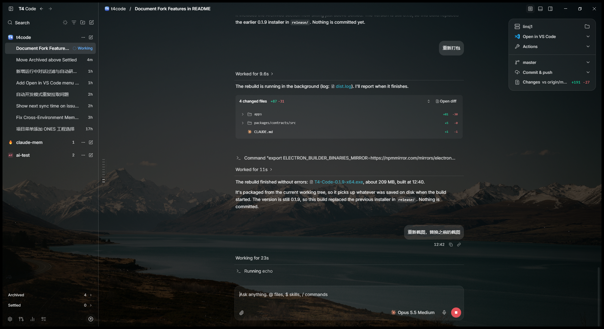

# T4 Code

T4 Code 是 [T3 Code](https://github.com/pingdotgg/t3code)（MIT）的个人分支，沿用 t3code 的架构（Node 服务端 + web/桌面/移动客户端），在其之上增加功能，定期通过 `git merge` 同步上游。目前只构建和使用桌面端。



## 与 T3 Code 的区别

### 可与 T3 Code 并存

独立的数据目录 `~/.t4`、协议 `t4code://`、应用 ID `com.t4code.app`，Windows 默认安装到 `%LOCALAPPDATA%\Programs\t4code`。安装器可选择安装目录，覆盖安装会保留快捷方式和任务栏固定。

### 外观

- **窗口背景图**：设置 → 外观，可分别设置背景图片、填充方式（铺满、适应、拉伸、平铺、居中）、不透明度和模糊（毛玻璃）。
- **玻璃高亮**：侧边栏当前对话、侧边栏工具项和选中文本工具栏使用会移动、拉伸并回弹的玻璃胶囊；跟随焦点和指针，并遵守系统的“减少动态效果”设置。
- **托盘图标**（Windows/Linux）：显示应用 / 设置 / 退出；关闭主窗口时隐藏到托盘而不退出。

### 侧边栏

- **默认按项目分组**，项目行上常驻"新建对话"按钮；没有对话的项目也显示文件夹；折叠的文件夹隐藏其全部对话（包括当前打开的）。
- **项目"…"菜单**替代折叠箭头：置顶 / 编辑（名称、图标、关联的工单项目）/ 关联工单 / 在资源管理器中打开 / 在 VS Code 中打开 / 归档 / 移除。
- **只看运行中**：侧边栏顶部开关，只保留正在运行、等待批准/输入/子对话或后台工作的对话，并隐藏空文件夹。
- **展开 / 折叠全部**：侧边栏标题栏可一键展开或折叠所有项目文件夹。
- **审批快捷菜单**：对话行的等待批准状态可直接展开菜单，就地批准、拒绝或选择“本次会话始终允许”；同一菜单也会列出子对话的待审批请求。
- **Archived**：归档的项目收进 Settled 上方可折叠的 Archived 区，在项目 "…" 菜单里取消归档即可移回。

### 分支管理

- **本地 / 远程分组**：分支选择器分组显示本地和远程分支，并继续支持搜索和创建新分支。
- **右键分支操作**：本地分支可检出、从该分支创建新分支、合并到当前分支、重命名、删除或复制名称；破坏性操作会先确认。

### 终端与 Actions

- **重启终端**：终端工具栏和侧边栏的每个终端行都有重启按钮；会重新打开 shell，并自动重跑该终端原先启动的项目脚本或 `launch.json` 配置，保留工作目录和环境变量。
- **运行状态标记**：从 Actions 启动的脚本或 `launch.json` 配置仍在运行时，菜单项会显示重启标记；点击可沿用原终端和配置重新启动。
- **并排终端**：连续启动的 Actions 会优先并排到同一终端组；`launch.json` 配置也会配对启动，终端分栏可拖动调整宽度。
- **服务重启**：对话的 Servers 面板可直接重启 localhost 端口转发或对应服务。

### 工单系统集成（ONES，Jira 预留）

- 设置 → 项目（未选中项目时）→ **Issues**：添加一个或多个工单系统连接，按状态筛选要列出的工单，把工单项目绑定到 T4 项目（一个工单项目可绑定多个 T4 项目）。
- **从工单开始对话**：在项目文件夹上打开工单选择器，选中工单后标题、描述和附件会带入输入框；同一工单不会重复创建对话。
- **立即拉取工单**：项目 "…" 菜单中的 Pull Issues Now 会立刻执行该项目的一次自动研发轮询，不必等待后台定时拉取。
- **自动研发**：开启后，描述以 `#!t4code` 开头的工单会被自动拉取并为每个工单启动一个对话。同一个 ONES 项目绑定多个 T4 项目时，可在标记同一行写目标 T4 项目标题（例如 `#!t4code qiko-manager`），工单只会在该项目启动；不写则沿用原来的自动选择。每次运行完成后：
  1. 把最后一条助手消息作为评论发回工单；
  2. 若该工单所属的 tracker 项目勾选了 Commit，则以 `#<工单号> <标题>` + 该总结为提交信息，提交并推送对话的代码；
  3. 若配置了完成状态，把工单流转到该状态。
- 从工单开始的对话点击 Commit 时，提交信息自动带上 `#<工单号>` 和标题。
- **工单看板**：侧边栏底部的 Issue board 入口（自动研发开启时显示）会打开独立页面，列出各 tracker 项目中分配给我的待处理工单，以及已有对话的已完成工单；可修改状态、一键执行。每行的圆点显示该工单对话的状态（红=失败、黄=进行中、绿=完成）。
- **Open Issue**：自动研发发起的对话，右侧对话详情面板 "Open in VS Code" 下方有 Open Issue，在浏览器中打开对应工单。

### 全局记忆（默认关闭）

设置 → 提供方 → 全局记忆。每隔 N 轮或 M 分钟（先到为准）对对话做总结，存为跨对话、跨项目的记忆；agent 可通过 MCP 工具 `t4_memory_search` / `t4_memory_recent` 检索。

### 选中文本翻译

- 在助手消息中选中文本后点击 **Translate**，会同时向所有已启用的翻译服务请求结果，并在浮层中并列显示；每条结果可单独复制。
- 设置 → 提供方 → **Translation**：设置目标语言、回退语言，以及可选的标识符拆分和换行预处理。
- 可配置多个 Google Cloud Translation v2 或 OpenAI-compatible 服务，并调整顺序、启用状态、超时、模型、提示词和自定义请求参数。API Key 按当前 environment 保存。

### VS Code 启动配置

- 对话详情 Actions 菜单中的 **From launch.json** 会读取项目的 `.vscode/launch.json`，支持启动 `node` / `node-terminal` 配置，并应用其中的 `cwd`、`env`、平台覆盖和 `${workspaceFolder}`。
- `debugpy` / `python` 配置会以普通 Python 进程运行（不连接调试器）：解释器优先取配置里的 `python`，其次取 `.vscode/settings.json` 的 `python.defaultInterpreterPath`；都没有时会弹出 **Select Interpreter**，可从工作区虚拟环境和 PATH 中选择，也可输入路径，选择会写回该设置。
- `launch.json` 和 `.vscode/settings.json` 会在窗口重新获得焦点时刷新。

### 其他

- 桌面更新检查和 release 历史默认指向 T4 Code 仓库，不再混用上游发布页。
- 桌面内置网页预览的初始窗口为 960 × 640，可继续拖动和缩放。
- 引用评论弹窗：点击外部或焦点移出等同于"取消"（丢弃草稿），上游是保存草稿。

维护说明（上游同步、改动了哪些上游文件、打包）见 [CLAUDE.md](./CLAUDE.md)。以下为上游 T3 Code 原始 README。

---

<p align="center">
  <a href="https://t3.codes">
    
  </a>
</p>

<h1 align="center">T3 Code</h1>

<p align="center">The open-source control plane for coding agents.</p>

<p align="center">
  <a href="https://t3.codes/download"><strong>Download</strong></a> ·
  <a href="https://apps.apple.com/us/app/t3-code-remote-claude-more/id6787819824">iOS</a> ·
  <a href="https://play.google.com/store/apps/details?id=com.t3tools.t3code">Android</a> ·
  <a href="https://app.t3.codes">Web</a> ·
  <a href="./docs/README.md">Docs</a> ·
  <a href="https://discord.gg/jn4EGJjrvv">Discord</a>
</p>

<p align="center">
  <a href="https://t3.codes">
    
  </a>
</p>

T3 Code runs the coding agents on your machine and gives them one fast interface. Start a thread at your desk, then approve the next step from your phone.

It works with Claude Code, Codex, Cursor, OpenCode, Grok Build, Antigravity, Kiro, Pi, Muse Code, fx, and any [ACP](./docs/user/providers-acp.md) agent. If an agent is set up on your computer, T3 Code can control it.

## What you get

- **Your subscriptions.** T3 Code does not resell tokens. It drives the agents you are already signed in to.
- **Every agent in one place.** Change models in the middle of a thread. Let Claude hand a task to Codex.
- **Desktop, web, and phone.** One server, and every client shows the same threads. There are apps for iOS and Android.
- **Remote ready.** Run agents on any machine. Connect over your local network, Tailscale, or [T3 Connect](./docs/user/remote-access.md).
- **Git built in.** Each thread can work in its own worktree. Review the diff, then commit, push, and open a pull request with one button.
- **Fast.** Performance is a feature here. We measure it, and we treat a dropped frame as a bug.
- **Open.** MIT licensed. If you don't like something, fork it.

## Install

### Desktop app

[Download T3 Code](https://t3.codes/download) for macOS, Windows, or Linux. You can also use a package manager:

| Platform       | Command                                                              |
| -------------- | -------------------------------------------------------------------- |
| macOS          | `brew install --cask t3-code`                                        |
| Windows        | `winget install T3Tools.T3Code` or `scoop install extras/t3code`     |
| Arch Linux     | `yay -S t3code-bin`                                                  |
| Nix            | `nix profile add github:NixOS/nixpkgs/nixos-unstable#t3code`         |
| Debian, Ubuntu | `.deb` from [Releases](https://github.com/pingdotgg/t3code/releases) |

### Command line

This installs the `t3` command. Run `t3` to start the server and open the web app.

```bash
curl -fsSL https://t3.codes/install.sh | sh
```

On Windows, in PowerShell:

```powershell
irm https://t3.codes/install.ps1 | iex
```

To try it once without an install, run `npx t3@latest`.

### Phone

Get the app from the [App Store](https://apps.apple.com/us/app/t3-code-remote-claude-more/id6787819824) or [Google Play](https://play.google.com/store/apps/details?id=com.t3tools.t3code). Then follow [remote access](./docs/user/remote-access.md) to connect it to your computer.

### Sign in to an agent

T3 Code needs one agent that is installed and signed in. For example, install [Claude Code](https://claude.com/product/claude-code) and run `claude auth login`, or install [Codex CLI](https://developers.openai.com/codex/cli) and run `codex login`.

[Provider setup](./docs/user/install.md#providers) has the steps for each agent. [Install T3 Code](./docs/user/install.md) covers nightly builds, AppImage, WSL, and NixOS.

## "Wait, what are you selling me?"

Nothing. We built T3 Code because we wanted the best possible development experience with agents. We were inspired by existing solutions like the Codex desktop app, Conductor, Claude Desktop and Cursor Glass, but none met our bar.

We wanted something performant, remote-ready, and truly open. If we ever go the wrong direction, we want you to have everything you need to fork and build the tool that you want.

## Documentation

- [Install and first run](./docs/user/install.md)
- [Remote access from a phone or another machine](./docs/user/remote-access.md)
- [Permission modes](./docs/user/permission-modes.md)
- [Source control](./docs/user/source-control.md)
- [Connect outside agents over MCP](./docs/user/outside-agents.md)
- [FAQ](./docs/user/faq.md)

[All docs](./docs/README.md) has the full list.

## Contributing

We have limited review capacity. Small, focused fixes are the most likely to be merged. Features need an approved discussion first.

- Read [CONTRIBUTING.md](./CONTRIBUTING.md) before you report a bug or open a pull request.
- Put feature requests in [Ideas](https://github.com/pingdotgg/t3code/discussions/categories/ideas).
- Build from source with the [development runbook](./docs/operations/development.md#first-checkout). The [architecture overview](./docs/internals/overview.md) explains how it works.
- Get help in [Discord](https://discord.gg/jn4EGJjrvv).

## License

[MIT](./LICENSE)
