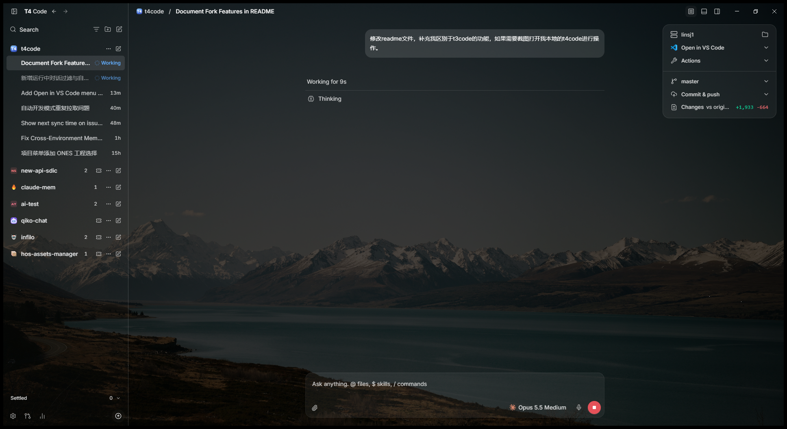

# T4 Code

T4 Code 是 [T3 Code](https://github.com/pingdotgg/t3code)（MIT）的个人分支，沿用 t3code 的架构（Node 服务端 + web/桌面/移动客户端），在其之上增加功能，定期通过 `git merge` 同步上游。目前只构建和使用桌面端。



## 与 T3 Code 的区别

### 可与 T3 Code 并存

独立的数据目录 `~/.t4`、协议 `t4code://`、应用 ID `com.t4code.app`，Windows 默认安装到 `%LOCALAPPDATA%\Programs\t4code`。安装器可选择安装目录，覆盖安装会保留快捷方式和任务栏固定。

### 外观

- **窗口背景图**：设置 → 外观，可选背景图片、不透明度和模糊（毛玻璃）。
- **托盘图标**（Windows/Linux）：显示应用 / 设置 / 退出；关闭主窗口时隐藏到托盘而不退出。

### 侧边栏

- **默认按项目分组**，项目行上常驻"新建对话"按钮；没有对话的项目也显示文件夹；折叠的文件夹隐藏其全部对话（包括当前打开的）。
- **项目"…"菜单**替代折叠箭头：置顶 / 编辑（名称、图标、关联的工单项目）/ 关联工单 / 在资源管理器中打开 / 在 VS Code 中打开 / 归档 / 移除。
- **只看运行中**：侧边栏顶部开关，只保留正在运行的对话并隐藏空文件夹。

### 工单系统集成（ONES，Jira 预留）

- 设置 → 项目（未选中项目时）→ **Issues**：添加一个或多个工单系统连接，按状态筛选要列出的工单，把工单项目绑定到 T4 项目（一个工单项目可绑定多个 T4 项目）。
- **从工单开始对话**：在项目文件夹上打开工单选择器，选中工单后标题、描述和附件会带入输入框。
- **自动研发**：开启后，描述以 `#!t4code` 开头的工单会被自动拉取并为每个工单启动一个对话。每次运行完成后：
  1. 把最后一条助手消息作为评论发回工单；
  2. 以 `<工单号> <标题>` + 该总结为提交信息，提交并推送对话的代码；
  3. 若配置了完成状态，把工单流转到该状态。
- 自动研发开启时，从工单开始的对话点击 Commit，提交信息自动带上工单号和标题。
- **工单看板**：侧边栏底部 "Issues" 按钮（自动研发开启时显示），列出绑定项目里分配给我的工单，可修改状态、一键执行；每行的圆点显示该工单对话的状态（红=失败、黄=进行中、绿=完成）。

### 全局记忆（默认关闭）

设置 → 提供方 → 全局记忆。每隔 N 轮或 M 分钟（先到为准）对对话做总结，存为跨对话、跨项目的记忆；agent 可通过 MCP 工具 `t4_memory_search` / `t4_memory_recent` 检索。

### 其他

- 引用评论弹窗：点击外部或焦点移出等同于"取消"（丢弃草稿），上游是保存草稿。

维护说明（上游同步、改动了哪些上游文件、打包）见 [CLAUDE.md](./CLAUDE.md)。以下为上游 T3 Code 原始 README。

---

# T3 Code

T3 Code is an "agent harness control surface". It enables control of the agents on your machine with a best-in-class mobile app ([iOS](https://apps.apple.com/us/app/t3-code-remote-claude-more/id6787819824), [Android](https://play.google.com/store/apps/details?id=com.t3tools.t3code)), [web app](https://app.t3.codes) and [Electron-based desktop app](https://t3.codes).

Works with your subscriptions on Claude Code, Codex, Cursor, Grok Build, OpenCode, Google Antigravity, and fx. If they're set up on your computer, T3 Code can control them.

## "Wait, what are you selling me?"

Nothing. We built T3 Code because we wanted the best possible development experience with agents. We were inspired by existing solutions like the Codex desktop app, Conductor, Claude Desktop and Cursor Glass, but none met our bar.

We wanted something performant, remote-ready, and truly open. If we ever go the wrong direction, we want you to have everything you need to fork and build the editor that you want.

## Installation

> [!WARNING]
> T3 Code currently supports Codex, Claude, Cursor, Grok Build, OpenCode, Antigravity, and fx. Install and authenticate at least one provider before use:
>
> - Codex: install [Codex CLI](https://developers.openai.com/codex/cli) and run `codex login`
> - Claude: install [Claude Code](https://claude.com/product/claude-code) and run `claude auth login`
> - Cursor: install [Cursor CLI](https://cursor.com/cli) and run `agent login`
> - Grok Build: install [Grok Build CLI](https://x.ai/cli) and run `grok login`
> - OpenCode: install [OpenCode](https://opencode.ai) and run `opencode auth login`
> - Antigravity: enable it in Settings, then use **Install Antigravity** and **Sign in with Google**. No CLI is required.
> - fx: install [fx](https://fx.sh) and run `fx login` on the machine running the T3 Code server ([setup guide](./docs/user/providers-fx.md))

### Command line

```bash
curl -fsSL https://t3.codes/install.sh | sh
```

On Windows, in PowerShell:

```powershell
irm https://t3.codes/install.ps1 | iex
```

Then run `t3` to start the server and open the local web app. `t3 service install` keeps it running in the background, `t3 update` moves to a newer release, and `t3 --help` has the full reference.

To try it once without installing, run `npx t3@latest`. It offers to install the `t3` command for you.

### Desktop app

Install the latest version of the desktop app from [GitHub Releases](https://github.com/pingdotgg/t3code/releases), or from your favorite package registry:

#### Windows (`winget`)

```bash
winget install T3Tools.T3Code
```

#### Windows (`scoop`)

```bash
scoop install extras/t3code
```

#### macOS (Homebrew)

```bash
brew install --cask t3-code
```

#### Debian, Ubuntu (`.deb`)

Download the `.deb` from [GitHub Releases](https://github.com/pingdotgg/t3code/releases), then:

```bash
sudo apt install ./T3-Code-*.deb
```

#### Arch Linux (AUR)

Stable:

```bash
yay -S t3code-bin
```

Nightly:

```bash
yay -S t3code-nightly-bin
```

The AUR packaging is maintained in this repository under [`packaging/aur`](./packaging/aur).

#### Nix (nixpkgs)

```bash
nix profile add github:NixOS/nixpkgs/nixos-unstable#t3code
```

The package is maintained in [nixpkgs](https://github.com/NixOS/nixpkgs/tree/nixos-unstable/pkgs/by-name/t3/t3code)
and includes the desktop app (`t3code-desktop`) and the `t3` command.
See [Nix installation](./docs/user/install.md#nix-nixpkgs) for NixOS configuration and updates.

## Some notes

We are very very early in this project. Expect bugs.

We are (mostly) not accepting contributions yet. Small fixes may be considered. Big features will not be.

## Documentation

Full docs live in [docs/](./docs). There's no docs site yet.

- [FAQ](./docs/user/faq.md)
- [Install and first run](./docs/user/install.md)
- [Permission modes](./docs/user/permission-modes.md)
- [Keyboard shortcuts](./docs/user/keybindings.md)
- [Project settings](./docs/user/project-settings.md)
- [Appearance preferences](./docs/user/appearance.md)
- [Remote access from a phone or another machine](./docs/user/remote-access.md)
- [Connect Claude Code, Codex, ChatGPT and other agents over MCP](./docs/user/outside-agents.md)
- [Keeping app and server in sync](./docs/user/updating.md)
- [Source control integrations](./docs/user/source-control.md)
- Multiple accounts: [Codex](./docs/user/providers-codex.md) · [Claude](./docs/user/providers-claude.md)
- [Run T3 Code as a background service](./docs/user/background-service.md)

Building from source? Start at [docs/internals/overview.md](./docs/internals/overview.md).

## If you REALLY want to contribute still.... read this first

### Install `vp`

T3 Code uses Vite+ so you'll need to install the global `vp` command-line tool.

#### macOS / Linux

```bash
curl -fsSL https://vite.plus | bash
```

#### Windows

```bash
irm https://vite.plus/ps1 | iex
```

Checkout their getting started guide for more information: https://viteplus.dev/guide/

### Install dependencies

```bash
vp i
```

Read [CONTRIBUTING.md](./CONTRIBUTING.md) before reporting a bug or opening a PR.

Have a feature request? Start an [Ideas discussion](https://github.com/pingdotgg/t3code/discussions/categories/ideas).

Need support? Join the [Discord](https://discord.gg/jn4EGJjrvv).
